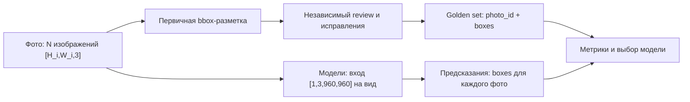

# Butterfly detection

Проект по детекции взрослых бабочек на фотографиях iNaturalist. Для каждого изображения нужно получить отдельную прямоугольную рамку каждой бабочки или подтвердить, что бабочек нет.

Процесс проекта: собрать фотографии, получить первичную bbox-разметку, провести независимый review, собрать golden set и сравнить готовые модели на одних и тех же изображениях. Обучение моделей не требуется.

**Сейчас в GitHub опубликован только README. Структура ниже — шаблон для размещения материалов. Скрипты review и их конфигурации ещё не созданы. Тетрадка Kaggle остаётся локально до тестового запуска; вариант для Colab ещё нужно подготовить.**

## Содержание

- [Данные и ссылки](#данные-и-ссылки)
- [Целевая структура](#целевая-структура)
- [Проект review](#проект-review)
- [Инструкция для разметки и review](#инструкция-для-разметки-и-review)
- [Тетрадки для промеров](#тетрадки-для-промеров)
- [Оценка и результаты](#оценка-и-результаты)
- [Полная инструкция задания](#полная-инструкция-задания)

## Данные и ссылки

Архивы хранятся на Яндекс Диске. Фотографии и веса не нужно помещать в Git.

| Архив | Ссылка на Диск | Содержимое |
|---|---|---|
| `butterflies.zip` | [Исходные данные](https://disk.yandex.ru/d/VypBgB5ddhvgPg) | Фотографии, семь XLSX-таблиц, примеры для инструкции и обучения исполнителей, изображения с нарисованными рамками. |
| `data.tar` | [Набор для промеров](https://disk.yandex.ru/d/94sRcTu-7YrUqw) | 40 исходных фото в `images/`, эталон `metadata/golden_frozen.jsonl`, описание набора и вспомогательные материалы. |
| `models.tar` | [Веса моделей](https://disk.yandex.ru/d/q3kDaO2YPeOIHA) | Каталоги `dino/`, `owlv2/`, `qwen/`, `yolo/`. В `yolo/` находится `yolov8m-oiv7.pt`. |

Для текущей конфигурации YOLO нужен **YOLOv8x-OIV7**: [отдельный файл `yolov8x-oiv7.pt`](https://github.com/ultralytics/assets/releases/download/v8.3.0/yolov8x-oiv7.pt). Он загружается тетрадкой отдельно или добавляется в Kaggle Input. Из `models.tar` для текущего сравнения используются веса OWLv2 base.

### Что находится в исходном архиве

Пути указаны относительно распакованного `butterflies.zip`.

| Путь | Назначение |
|---|---|
| `photos/butterflies_main_400/` | 400 фотографий основного набора для разметки и review. |
| `tables/butterflies_main_400.xlsx` | Таблица основного набора; golden set для него должен быть получен по итогам bbox и review. |
| `photos/butterflies_40_annotated/` | 40 исходных фотографий проверочного набора. |
| `tables/butterflies_40_annotated.xlsx` | Разметка этих 40 фото. |
| `tables/bbox_exam_10.xlsx` | 10 примеров экзамена для первичной bbox-разметки. |
| `tables/review_exam_10.xlsx` | 10 примеров экзамена для review. |
| `tables/review_control_20.xlsx` | 20 контрольных примеров для review. |
| `photos/instruction_5/`, `tables/instruction_5.xlsx` | 5 примеров для инструкции. |
| `photos/training_5/`, `tables/training_5.xlsx` | 5 примеров для обучения исполнителей. |

Внутри групп `butterflies_40_annotated`, `instruction_5` и `training_5` есть подпапки `annotated/` с нарисованными рамками. **Моделям передаются оригиналы из корня группы, а не изображения из `annotated/`.**

Пять примеров в инструкции — это сценарии, а не пять классов. Целевой класс один: взрослая бабочка.

В проверочном наборе из 40 фото: **24 изображения с бабочками, 16 без бабочек и 33 эталонные рамки**. Этот набор используется для настройки и локального сравнения моделей. Он не заменяет основную разметку 400 изображений.

### Как расположить данные локально

После скачивания архивов целевое расположение такое:

```text
data/
├── archives/
│   ├── butterflies.zip
│   ├── data.tar
│   └── models.tar
├── source/             # распакованный butterflies.zip: photos/ и tables/
├── benchmark40/        # распакованный data.tar: images/, metadata/, reproduction/
├── models/             # распакованный models.tar
└── kaggle/
    ├── butterfly_positive_24/
    └── butterfly_negative_16/
```

Архивы можно распаковать из корня проекта:

```bash
mkdir -p data/source data/benchmark40 data/models
unzip data/archives/butterflies.zip -d data/source
tar -xf data/archives/data.tar -C data/benchmark40
tar -xf data/archives/models.tar -C data/models
```

Для финальной Kaggle-тетрадки нужны два отдельных пакета:

```text
butterfly_positive_24/            butterfly_negative_16/
├── dataset.json                 ├── dataset.json
├── models.json                  ├── models.json
├── golden.jsonl                 ├── golden.jsonl
└── images/                      └── images/
```

В рабочем каталоге они уже подготовлены в `data_labeling/final/kaggle_datasets/`. Готовые архивы — `data_labeling/final/butterfly_positive_24.zip` и `data_labeling/final/butterfly_negative_16.zip`. Отдельных ссылок на Диск для этих двух пакетов пока нет.

## Целевая структура

Это **шаблон**, а не список уже опубликованных файлов. Пути скриптов и конфигураций задают места, куда их нужно добавить.

```text
butterfly-detection/
├── README.md
├── requirements.txt
├── configs/
│   └── review/
│       ├── project.json         # поля задания, ответы и параметры проекта
│       ├── exam_pool.json       # экзамен и допуск по навыку
│       └── review_pool.json     # основной пул, оплата, перекрытие, контроль качества
├── templates/
│   └── review/
│       └── interface.html       # полный кадр и предложенные рамки
├── instructions/
│   ├── bbox.md
│   └── review.md
├── scripts/
│   ├── data/
│   │   └── prepare_benchmark.py  # подготовка двух пакетов для Kaggle
│   └── review/
│       ├── create_project.py    # создание проекта из шаблона и инструкции
│       ├── configure_pools.py   # экзамен, навык, основной пул и контроль качества
│       ├── prepare_tasks.py     # преобразование bbox-ответов в задания review
│       ├── upload_tasks.py      # загрузка подготовленных заданий в пул
│       └── export_results.py    # выгрузка вердиктов и списка исправлений
├── notebooks/
│   ├── kaggle/
│   │   └── butterfly_final.ipynb
│   └── colab/
│       └── butterfly_final_colab.ipynb
├── data/                        # архивы, фотографии, эталон и веса; хранятся отдельно
└── results/
    ├── owl_predictions.json
    ├── yolo_predictions.json
    ├── metrics.csv
    ├── settings.json
    └── best_model.json
```

Сейчас рабочие файлы находятся вне этого репозитория, в каталоге `data_labeling/final/`:

| Рабочий путь | Назначение |
|---|---|
| `final/final_project_2026.md` | Markdown-версия исходного задания; полный текст приведён ниже. |
| `final/other/photos/`, `final/other/tables/` | Распакованные исходные данные. |
| `final/prepare_butterfly_datasets.py` | Текущий упаковщик двух наборов по 24 и 16 фото. Основа для будущего `scripts/data/prepare_benchmark.py`. |
| `final/kaggle_datasets/` | Подготовленные входы финальной тетрадки. |
| `final/butterfly_final.ipynb` | Финальная тетрадка OWLv2 base и YOLOv8x для проверки на Kaggle. |
| `final/butterfly_benchmark_final.py` | Код, из которого собрана тетрадка. |
| `final/build_butterfly_final.py` | Сборка самостоятельного `.ipynb`. |

## Проект review

Review — отдельный этап проверки bbox-разметки в Яндекс Заданиях. Ревьюер видит весь кадр и предложенные рамки. Он ищет пропуски, лишние рамки и неточные границы.

### Где будут скрипты

Все скрипты review запланированы в `scripts/review/`:

- `create_project.py` — создаёт проект с полями входа и ответа, интерфейсом из `templates/review/interface.html` и инструкцией из `instructions/review.md`.
- `configure_pools.py` — создаёт экзамен, навык допуска и основной review-пул по конфигурациям из `configs/review/`.
- `prepare_tasks.py` — связывает фото с первичными рамками и автором ответа. Готовит контрольные примеры и данные для исключения проверки собственной работы.
- `upload_tasks.py` — отправляет подготовленные задания в нужный пул.
- `export_results.py` — выгружает вердикты и комментарии, формирует список принятых ответов, исправлений и случаев для ручного разбора.

**Эти скрипты ещё не реализованы. Команд запуска для них пока нет.**

### Где будут настройки

| Файл | Какие настройки в нём хранятся |
|---|---|
| `configs/review/project.json` | Название проекта, входные поля фото и рамок, выходной вердикт и комментарий, параметры интерфейса. |
| `configs/review/exam_pool.json` | Экзаменационные задания, проверенные ответы, порог допуска и выдача навыка. |
| `configs/review/review_pool.json` | Навык и порог допуска, оплата, число заданий на странице, перекрытие, лимиты расходов, контрольные задания и правила контроля качества. |
| `templates/review/interface.html` | Отображение полного кадра, рамок и элементов ответа. |
| `instructions/review.md` | Инструкция ревьюеру; её содержание описано в следующем разделе. |

Значения оплаты, перекрытия и порога допуска команда должна выбрать перед запуском. Автор первичного ответа не должен получать собственную работу на review. Исходные рамки, вердикты и исправления сохраняются отдельно, чтобы было видно происхождение итогового golden set.

## Инструкция для разметки и review

### Что считать бабочкой и как ставить рамку

1. Размечать всех взрослых бабочек на фотографии. Каждую выделять отдельной рамкой, включая перекрывающиеся объекты.
2. Рамка плотно охватывает видимые крылья, тело, усики и лапки. Стороны рамки параллельны краям фотографии.
3. Если бабочка закрыта другим объектом или обрезана краем кадра, выделять только видимую часть. Скрытые части не достраивать.
4. Не выделять молей, других насекомых, гусениц, куколок и тени.
5. Если бабочек нет, оставить пустой список рамок. Ошибку загрузки изображения отмечать отдельно.
6. Неоднозначный объект отправлять на дополнительный разбор.

В итоговых данных рамка задаётся нормализованными `left`, `top`, `width`, `height` в диапазоне от 0 до 1. `left` и `top` — левый верхний угол. Пустой `boxes` означает подтверждённое отсутствие бабочек.

### Что делает ревьюер

1. Проверяет, что изображение загрузилось и виден весь кадр. Ошибка загрузки не считается пустым изображением.
2. Осматривает весь кадр: нет ли пропущенных бабочек, включая мелкие и частично закрытые объекты.
3. Проверяет каждую предложенную рамку: это действительно бабочка, рамка отдельная и плотно охватывает видимую часть.
4. Принимает полностью верную разметку. Ответ с пропусками, лишними рамками или неверными границами отправляет на исправление с пояснением.
5. Неоднозначные случаи передаёт на ручной разбор. Не заменяет сомнение автоматическим принятием или пустым ответом.

После review ответ принимается, исправляется или разбирается вручную. Итоговая разметка всех основных фото образует golden set.

## Тетрадки для промеров

| Среда | Планируемый путь в репозитории | Состояние |
|---|---|---|
| Kaggle | `notebooks/kaggle/butterfly_final.ipynb` | Рабочий файл есть локально в `data_labeling/final/butterfly_final.ipynb`. Публикация отложена до тестового запуска на двух T4. |
| Colab | `notebooks/colab/butterfly_final_colab.ipynb` | Шаблон места для отдельной адаптации. Тетрадка ещё не подготовлена. |

### Запуск Kaggle

1. Импортировать локальный `butterfly_final.ipynb` в Kaggle Notebook.
2. Включить **GPU T4 ×2** и **Internet**.
3. Добавить два Input-датасета: `butterfly_positive_24` и `butterfly_negative_16` с указанной выше структурой.
4. При желании добавить `models.tar` и отдельный `yolov8x-oiv7.pt`. Без локальных весов тетрадка скачает их сама.
5. Выполнить **Run All**. Каждый запуск заново обрабатывает все 40 фото.
6. Скачать `butterfly_results.zip` из последней ячейки.

Текущая тетрадка рассчитана на пути `/kaggle/input`, `/kaggle/working` и две T4. Для Colab нужно отдельно адаптировать пути и распределение фотографий по доступным GPU. Запуск текущей версии в Colab не проверен.

### Настройки моделей

| Модель | Confidence | NMS вида | Финальный NMS |
|---|---:|---:|---:|
| OWLv2 base | 0,25 | 0,5 | 0,5 |
| YOLOv8x-OIV7 | 0,45 | 0,7 | 0,8 |

Общий пайплайн: вход 960×960, исходное фото и отражение, NMS каждого вида, подтверждение рамки двумя видами при IoU ≥ 0,35, среднее координат с весами score и финальный NMS. Подготовка пикселей — штатная для каждой модели.

## Оценка и результаты

Для каждой модели сохраняются предсказания и рассчитываются:

- F1@IoU 0,5, precision и recall;
- число ошибок FP+FN;
- время обработки;
- F1@IoU 0,75;
- число ложных рамок на фотографиях без бабочек.

Числа TP, FP и FN суммируются по всем изображениям. Каждая рамка участвует не более чем в одной паре. Критерий выбора — лучший F1@IoU 0,5; при равенстве можно предпочесть более быструю модель.

Эталон читается после предсказаний и моделям не передаётся. Техническая ошибка не подменяется пустой разметкой. Время включает подготовку входа, модель и обработку рамок; чтение файлов, загрузка весов и прогрев исключены.



## Полная инструкция задания

Ниже приведена Markdown-версия исходного задания из рабочего файла `final/final_project_2026.md`. Это требования ко всему финальному проекту; текущая тетрадка двух моделей покрывает его часть, связанную с промерами OWLv2 и YOLO.

<details>
<summary>Развернуть полную инструкцию финального проекта</summary>

# Финальный проект: разметка данных и выбор модели

## О задании

Представьте, что вы — исследовательская команда, которая готовит пилот проекта по мониторингу биоразнообразия для заявки на научный грант в Yandex Cloud. Команде нужен инструмент, который находит бабочек на фотографиях и выделяет их рамками для дальнейшего анализа биологами. Прежде чем масштабировать обработку, нужно понять, какой готовой модели можно доверить эту задачу и где она ошибается.

Ваша задача — подготовить эталонную разметку, сравнить модели и обосновать выбор решения. Бюджет пилота ограничен, поэтому качество данных и организация проверки важны не меньше самой модели.

Вы организуете разметку в Яндекс Заданиях, исправите спорные случаи и сравните готовые локальные модели на полученном датасете. Обучать или дообучать модели не требуется. Платные API моделей для выполнения задания не нужны.

Главный результат — это воспроизводимый процесс:

**Фотографии → разметка рамок → независимая проверка → golden set → сравнение моделей → выбранное решение.**

На защите важно объяснить, почему вашей разметке можно доверять и на каких измерениях основан выбор модели.

## Особенности командного задания

Распределите работу между участниками: подготовка данных, настройка проектов разметки и проверки, контроль качества, эксперименты с моделями и подготовка защиты. Роли можно совмещать. Укажите вклад каждого участника в презентации.

В команде **4–5 человек**. Выберите капитана: он сдаёт общий результат и отправляет предсказания итоговой модели в Контест со своего аккаунта. Для участия в Контесте сообщите преподавателю логин капитана. Оценка засчитывается всей команде. Каждый участник должен понимать постановку задачи и основные решения команды. Порядок доступа к аккаунтам Яндекс Заданий сообщит преподаватель.

На защиту отводится **7 минут на презентацию и 5 минут на обсуждение**.

## 1. Что нужно сделать?

### Постановка задачи

На вход алгоритм получает фотографию. На выходе — прямоугольные рамки всех взрослых бабочек. Если бабочек нет, ответ — пустой список.

Правила разметки:

- Каждая бабочка выделяется отдельной рамкой, даже если несколько объектов перекрываются.
- Рамка плотно охватывает видимые части объекта: крылья, тело, усики и лапки.
- Если бабочка закрыта другим объектом или обрезана краем фотографии, выделяется её видимая часть. Скрытые части не достраиваются.
- Другие насекомые, моли, гусеницы, куколки и тени не размечаются.
- Неоднозначный объект требует дополнительного разбора. Ошибка загрузки изображения не считается отсутствием бабочки.

Эти правила должны совпадать в инструкции исполнителям, итоговой разметке и оценке моделей.

### Подготовить данные

Самостоятельно соберите на [iNaturalist](https://www.inaturalist.org/) датасет для сравнения моделей. Рекомендуемый объём — **400 фотографий**. Состав выборки спроектируйте сами, опираясь на раздел 2. Используйте только фотографии с лицензией **CC0**. Скачайте изображения, проверьте, что они открываются, удалите дубликаты и сохраните идентификаторы и ссылки на источники. Перед запуском разметки зафиксируйте итоговый список фотографий.

### Создать проект разметки bbox

Настройте проект в Яндекс Заданиях, в котором исполнители выделяют бабочек рамками. Подготовьте понятную инструкцию и примеры: обычный объект, несколько бабочек, перекрытие, похожее насекомое и изображение без бабочек.

Предусмотрите отдельные ответы для отсутствия объектов и ошибки загрузки. Проверьте интерфейс самостоятельно до запуска платных заданий.

Организуйте допуск исполнителей: подготовьте экзамен и правило выдачи навыка. Обоснуйте порог допуска, оплату, число заданий на странице и перекрытие. Параметры выбирает команда в пределах общего бюджета.

### Создать отдельный проект review

Второй проект предназначен для проверки предложенной разметки. Ревьюер должен видеть весь кадр и рамки, чтобы находить пропущенных бабочек, лишние выделения и неточные границы.

Автор первичного ответа не должен проверять собственную работу. Для ревьюеров также предусмотрите экзамен, навык и порог допуска. Контрольные примеры должны иметь заранее проверенные ответы.

Опишите, как из нескольких проверок получается решение: принять ответ, отправить на исправление или разобрать вручную. Не ограничивайтесь запуском двух проектов — покажите, как ответы переходят между этапами и кто отвечает за окончательную разметку.

### Собрать golden set

Получите итоговую проверенную разметку **всех фотографий вашего датасета**. Для каждой фотографии должны быть сохранены рамки или подтверждённое отсутствие бабочек.

Разберите отклонённые и спорные ответы. Сохраните исходную разметку, вердикты ревьюеров и исправления с коротким пояснением. Если для исправлений использовалась модель, отметьте это отдельно: её ответы не являются независимой человеческой проверкой.

Проверьте выборку итоговых ответов самостоятельно. В отчёте приведите несколько найденных ошибок и объясните, как их удалось обнаружить. Посчитайте расходы на экзамены, основную разметку, ревью и исправления.

### Сравнить готовые модели и выбрать лучшую

Обязательно сравните **все три модели** из списка:

| Модель | Как используется |
| --- | --- |
| Grounding DINO tiny | Находит объекты по текстовому запросу, например `butterfly.` |
| OWLv2 base | Независимый детектор, которому также задаётся текстовое описание объекта |
| Qwen3-VL-2B-Instruct | Возвращает координаты рамок по инструкции; допускается локальная версия с 4-битными весами |

По желанию найдите **четвёртую открытую модель вне этого списка** и включите её в сравнение. Объясните, почему выбрали её и чего ожидаете от результата. Это дополнительный эксперимент; сравнение трёх перечисленных моделей обязательно.

**Все выбранные модели оцениваются на всём собранном датасете по итоговой разметке, на одинаковом наборе фотографий.**

Для каждой модели сохраните предсказания и посчитайте F1@IoU 0,5, precision, recall, число ошибок и время обработки. Покажите также F1@IoU 0,75 и ложные срабатывания на фотографиях без бабочек.

Проведите хотя бы один дополнительный эксперимент, меняя один фактор: текстовый запрос, порог уверенности или удаление дублирующихся рамок. Сформулируйте ожидание до запуска, сравните результат на том же полном наборе фотографий и объясните наблюдение. Если изменение не улучшило качество, это тоже результат эксперимента.

Выберите конфигурацию с лучшим F1@IoU 0,5. При равенстве можно предпочесть более быструю. Зафиксируйте версию весов, настройки, запрос, преобразования изображения и обработку рамок. Модель получает только изображение: категория источника и эталонные ответы ей не передаются.

## 2. Исходные данные

Каждая команда самостоятельно проектирует и собирает выборку из iNaturalist. **Рекомендуемый объём — 400 фотографий.** Категории и их пропорции выбираете вы.

Обоснуйте состав датасета: какие сценарии он покрывает, какие ошибки моделей позволяет выявить и какие ограничения есть у такого сравнения.

В отчёте покажите результаты как на всём наборе, так и по выбранным группам.

Категория наблюдения в iNaturalist не заменяет разметку: например, на фотографии цветка может оказаться бабочка. Наличие объектов определяется после проверки изображений.

### Как скачать фотографии

Используйте метод `GET /v1/observations` из [документации API iNaturalist](https://api.inaturalist.org/v1/docs/). Он возвращает наблюдения и ссылки на фотографии. Основные параметры:

- `taxon_id` — идентификатор нужного таксона. Его можно взять из адреса страницы таксона на сайте; например, `47224` — бабочки Papilionoidea.
- `photos=true` — только наблюдения с фотографиями.
- `photo_license=cc0` — фотографии с лицензией CC0.
- `per_page=200` и `page` — размер страницы и её номер для последовательной загрузки результатов.

Вот [пример запроса для фотографий бабочек с CC0](https://api.inaturalist.org/v1/observations?taxon_id=47224&photos=true&photo_license=cc0&per_page=200&page=1). Для выбранных вами категорий подберите подходящие таксоны. Для отбора сложных случаев, например перекрытий или мелких объектов, дополнительно просмотрите изображения.

Фотографии находятся в `results[].photos`. Скачивайте их по ссылке из поля `url`; для полного размера замените `/square.` на `/original.`. У каждой выбранной фотографии проверьте `license_code`: значение должно быть `cc0`. Лицензии наблюдения и фотографии могут различаться, а в одном наблюдении могут быть фотографии с разными лицензиями. Подробнее — в [справке iNaturalist о лицензиях](https://help.inaturalist.org/en/support/solutions/articles/151000175695).

В заданиях для исполнителей можно использовать прямые HTTPS-ссылки на фотографии из публичного S3-бакета iNaturalist — загружать копии в собственное хранилище не обязательно. Формат ссылки описан в [документации iNaturalist Open Data](https://github.com/inaturalist/inaturalist-open-data): домен `https://inaturalist-open-data.s3.amazonaws.com`, путь `/photos/{photo_id}/original.{extension}`. Подставьте идентификатор и расширение конкретной фотографии. Проверьте, что ссылка открывается без авторизации; требование лицензии CC0 сохраняется.

Сохраните ссылки на исходные наблюдения, идентификаторы фотографий, сведения об авторстве и лицензиях. Сравнение моделей проводится по разметке вашей команды. Готовая разметка авторского решения не заменяет прохождение этапов bbox и review.

## 3. Какой бюджет и какие вычисления нужны?

Бюджет разметки — **850 рублей на команду**. В эту сумму должны уложиться экзамены, основная разметка, перекрытие, ревью, исправления и комиссия платформы.

Если бюджета не хватило, можно запросить у преподавателя **ещё 300 рублей**. За получение дополнительного бюджета итоговая оценка за проект снижается на **30%**: сумма баллов за архитектуру и качество умножается на **0,7**.

Модели запускаются локально и последовательно. Обучение весов и платные API в этом задании не используются. Можно применять готовые квантованные веса. 

Не расходуйте весь бюджет без проверки: сначала запустите небольшой пилот, оцените понятность инструкции и ошибки, затем переходите к основному объёму.

## 4. Что нужно сдать?

От команды ждём **посылку в Контесте и презентацию на защиту**.

1. **Посылка в [Яндекс Контесте](https://contest.yandex.ru/contest/103082/).** Капитан загружает предсказания выбранной модели на экзаменационном датасете.
2. **Презентация к дате защиты.** Расскажите, как собрали датасет, организовали разметку и ревью, проверяли качество и исправляли ошибки. Покажите расходы, эксперименты, какие метрики использовали, сравнение моделей и объясните итоговый выбор. Укажите вклад каждого участника.

В презентации должна быть **ссылка на репозиторий проекта** со всеми материалами: кодом, инструкцией запуска и зависимостями, датасетом, лидербордом, настройками экспериментов и предсказаниями моделей. Датасет можно хранить отдельно, например на Hugging Face Datasets, и дать ссылку из README репозитория.

Также сохраните в репозитории или по ссылкам из него исходные ответы исполнителей, результаты ревью, ссылки на проекты bbox и review, инструкции и настройки экзаменов, допуска и контроля качества. 

### Формат результатов модели

Один файл JSONL: одна строка на фотографию. Координаты нормализованы в диапазон от 0 до 1. `left` и `top` — левый верхний угол, `width` и `height` — размеры рамки.

```json
{"photo_id": 123, "boxes": [{"left": 0.1, "top": 0.2, "width": 0.3, "height": 0.4}], "error": null}
{"photo_id": 124, "boxes": [], "error": null}
```

Пустой список означает, что модель успешно обработала изображение и не нашла бабочек. Ошибку обработки нельзя подменять пустым списком. Перед итоговой сдачей устраните технические ошибки; сохраните их причины и повторные попытки в отдельном журнале. В файле для Контеста поле `boxes` должно содержать список, а поле `error` — значение `null` или отсутствовать. Включите все 400 идентификаторов из выданного датасета, каждый ровно один раз. Загрузите файл JSONL размером до 5 МиБ и выберите `(make) python-handbook` в поле компилятора.

## 5. Как формируется оценка?

Максимальная оценка — **20 баллов**.

### Архитектура проекта и защита — 10 баллов

| Критерий | Баллы | Что нужно показать |
| --- | ---: | --- |
| Данные и инструкция | 2 | Обоснованный состав датасета, происхождение данных, понятные правила рамок и примеры |
| Bbox, review и контроль качества | 3 | Два работающих проекта, допуск исполнителей, независимые проверки, разбор ошибок и расходы |
| Анализ моделей | 3 | Сравнение трёх обязательных моделей на всём наборе, эксперимент с одним фактором и обоснованный выбор |
| Воспроизводимость и защита | 2 | Полный пакет, повторяемый запуск, ясную презентацию и ответы на вопросы |

Количество запусков, размер модели и стоимость оборудования не оцениваются. Важны качество организации разметки и выводы, подтверждённые результатами.

### Качество автоматической разметки — 10 баллов

Для оценки команды получат **отдельный экзаменационный датасет без эталонной разметки**. Он не входит в выборку, которую вы собираете самостоятельно.

Запустите на выданных изображениях выбранное решение с зафиксированными настройками и загрузите файл предсказаний в Яндекс Контест. Качество будет оценено по скрытой эталонной разметке. 

Предсказания должны быть получены автоматически, без ручного исправления рамок. Преподаватель сможет воспроизвести результат по сданному коду и настройкам.

Основная метрика — **object F1@IoU 0,5**. IoU — отношение площади пересечения двух рамок к площади их объединения. Внутри каждого изображения оценщик находит максимальное число пар «эталонная рамка — предсказанная рамка» с IoU не ниже 0,5. Каждая рамка участвует не более чем в одной паре.

- **TP** — число сопоставленных пар.
- **FP** — лишние предсказанные рамки.
- **FN** — пропущенные эталонные рамки.

Сначала эти числа суммируются по всему набору, затем считается:

**F1 = 2 × TP / (2 × TP + FP + FN).**

Правильный пустой ответ на фотографии без бабочек не добавляет TP. Лишняя рамка на такой фотографии увеличивает FP. Поэтому модели недостаточно находить бабочек: она должна уметь не выделять фон и похожих насекомых.

> Предлагаемая шкала: **баллы за качество = int(min(10, 10 × (F1 + 0.3)))**. Например, F1 = 0,72 даёт 10 баллов. 

Лидерборд на датасете команды нужен для выбора модели. Баллы за качество выставляются по закрытому экзамену, а не по этому лидерборду.

## На что обратить внимание?

Перед основным запуском проверьте интерфейсы, инструкции и контрольные примеры на небольшом пуле. Убедитесь, что задания с несколькими бабочками и без бабочек обрабатываются корректно.

Следите за бюджетом и числом выдаваемых заданий. Высокое согласие ревьюеров не гарантирует правильный ответ: покажите в отчёте реальные примеры проверенной итоговой разметки.

В экспериментах сохраняйте ответы всех моделей, включая ошибки. Не исключайте сложные фотографии из метрик. Объясняйте различия в precision и recall на конкретных изображениях.

## Сроки и вопросы

- **20 ноября 2026 года — сдача предсказаний в Контест для всех команд**. Выходные после сдачи можно посвятить подготовке презентации.
- **23 ноября 2026 года — защита ШАД.**
- **30 ноября 2026 года — защита ИИ360.**

Презентацию подготовьте к дате своей защиты. Вопросы по заданию задавайте в чате курса.

## Обратная связь о вкладе в командную работу

После сдачи решения в Контесте **каждый участник команды** должен заполнить [форму обратной связи](https://forms.yandex.ru/surveys/13810938.19aca11a7580b7fe682c4fba0f927405dcebed6f) и оценить вклад каждого своего сокомандника в итоговую работу.

В команде из **4 человек** каждый заполняет форму **на трёх сокомандников**, а в команде из **5 человек — на четырёх**. Заполнение на одного человека займёт **1–2 минуты**: в форме один бинарный вопрос и поле для свободного ответа.

### Зачем нужна форма?

Финальное задание командное, поэтому итоговая оценка пойдёт в ведомость каждому участнику. Мы считаем, что будет нечестно ставить оценку тому, кто совсем не помогал своей команде. Надеемся, что таких случаев не будет. Если вы не планируете делать финальное задание, заранее сообщите об этом остальным участникам команды.

</details>
